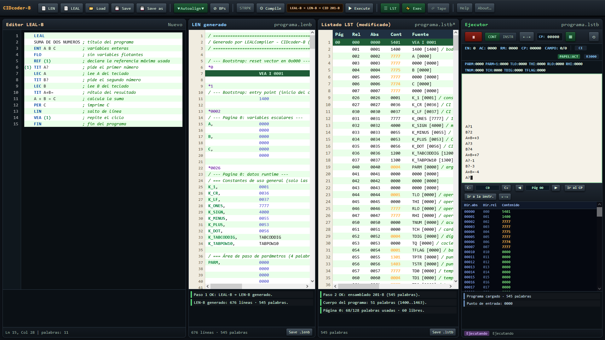

# CIDcoder-B

**Editor, compilador LEAL-B, ensamblador LEN-B y ejecutor de la minicomputadora cubana CID 201-B, todo en una sola página HTML.**

CIDcoder-B continúa el proyecto **CIDcoder-A** para la **CID 201-B**. Conserva el editor y el lenguaje LEAL, pero compila a **LEN-B** y ejecuta sobre la memoria de **8 campos**, el direccionamiento de 15 bits y el teletipo de papel **Ricoh 3000**. No hay instalación ni dependencias: se abre en el navegador.

<p align="center"></p>


## Estado actual (0.1.5)

| Área | Estado |
|---|---|
| Núcleo `CORE201B` | Implementado: CI/CM/CD/CO/CV, IRM, microinstrucciones, autoíndices, VAS/VPP, interrupciones, CODEC y E/S |
| Teletipo `RICOH3000` | Implementado: papel de 60 columnas, `Enter` = CR, siempre en modo computadora y eco software del programa |
| Ensamblador **LEN-B** | Implementado: IRM, micros, rotaciones, E/S, cadenas CI, datos, etiquetas, `.lstb` |
| Compilador **LEAL-B** | Implementado: compila a LEN-B para la 201-B (enteros, flotantes, arreglos, cadenas, ciclos, subrutinas y funciones) |
| Runtime LEAL-B | Implementado, medido y auditado: **3296** palabras UNPK / **3308** PKD |
| Ejecutor LEN-B | Implementado sobre `CORE201B`/`RICOH3000`, campo 0, CP de 15 bits y visor de 8 campos |
| Monitor de teletipo 201-B | Implementado: `MONITOR_TELETIPO_201B`, **176 palabras** en páginas 29/30, comandos `R`/`A`/`C` sobre la Ricoh, eco software y auditoría `LAC` aplicada |
| Monitor «Última Página» | Implementado: **107 palabras** en la página 31, con **21 libres** para la futura gestión de campos |

## La CID 201-B

| | |
|---|---|
| Palabra | 12 bits |
| Memoria | 8 campos × 4096 palabras = 32 768 palabras |
| Organización | 32 páginas × 128 palabras por campo |
| Direcciones | 15 bits, octal de 5 dígitos (`00000`–`77777`); campo 0…7 + página + posición |
| Ejecución de CIDcoder-B | Campo 0 |
| Registros | AC, EN, RM, CP, RCI, RCD, RNI, RVI |
| Teletipo | Ricoh 3000 de papel, siempre en modo computadora |
| Periférico LEAL | `SEP 7,7` (Ricoh 3000) |

La máquina usa **complemento a dos** y representación **octal**. El CP es de 15 bits; el campo de instrucción vive en `RCI` y el de datos en `RCD`.

## Lenguaje LEAL-B

El editor reconoce un fuente LEAL por la extensión `.leal` o por la primera línea `LEAL`. La compilación produce LEN-B y se ejecuta en el campo 0.

```leal
LEAL
HOLA
ENT A
FLO B
REF (1)
TIT NOMBRE:
LCA A
TIT HOLA,
PCA A
LIN
5 = B
PER B
FIN
```

Diferencias principales respecto de CIDcoder-A:

- **Código interno CI de 6 bits**, terminador **CI 36** (`0o44`). Las cadenas empaquetadas guardan dos caracteres por palabra: el primero en los 6 bits bajos.
- **`PER` sin relleno por la izquierda**. Entero = signo + dígitos + 2 espacios; flotante = signo + `Entero.Fracción` + 3 espacios. Los positivos llevan `+`; el cero no lleva signo.
- **`TIT` añade LF + CR** antes del terminador. La Ricoh cuenta el par como un solo salto visible y deja el cursor al inicio de la línea siguiente. `LIN` emite CR + LF con el mismo efecto visible.
- **`DIG m,n`**: `n` (0…5) fija los decimales; por defecto `DIG 6,3`. La forma `DIG m` se rechaza con `E:DIGEXP`.
- **`SEP`**: solo se acepta `SEP 7,7` (Ricoh). Otro periférico produce `E:PERIF` y detiene el programa.
- **`LEC`**: entero de 24 bits con signo; flotante con magnitud menor que 2²³. Una entrada flotante mayor o igual que `8388608` produce `E:DESB`.
- **Cadenas:** `LCA`/`PCA`, `MDI`/`MID`, `ESP`, `TIT`, `LIN` y comparación por CI.
- **Ciclos y subrutinas:** `CIC`/`REP`, `VAS`/`CRU`/`FRU`, `REF`, condiciones `SSP`/`SNN`/`SSC`/`SNP`/etc., `VEA`, `ALT` y `FIN`.

### Campo 0

La ejecución de LEAL-B vive en el **campo 0**. Las variables escalares comienzan en `0020`; `0010`–`0017` están reservados para autoíndices. La tabla de punteros de salto debe terminar antes de `0200`, donde empiezan las rutinas del runtime.

Ese límite es real: varios programas del corpus heredado no caben en el campo 0 de la 201-B y se informan como **`Página 0 desborda`**, no como un solapamiento interno. Los programas afectados se documentan y se omiten en la paridad; no se fuerza su ajuste reduciendo el runtime.

## LEN-B

**LEN-B** es el ensamblador nativo de la CID 201-B. El editor lo reconoce por la extensión `.lenb`.

```lenb
*0000
start,  SIL              / ¿tecla lista?
        VEA start
        TLA              / tecla → AC
        TAP              / imprime en el Ricoh
        VEA start
$
```

- **Sintaxis:** `ETIQUETA, INSTRUCCIÓN`; comentario con `/`; fin opcional con `$`.
- **Números:** octal por defecto, `0o` octal, `0d` decimal, `0x` hexadecimal y negativos a 12 bits.
- **IRM:** `YLO`, `SUM`, `ISC`, `DEL`, `VAS`, `VEA`.
- **Direccionamiento directo:** solo página 0 o página actual. Para otra página se usa indirección (`I` o `@`), con el puntero en página 0 o en la página actual.
- **Micros canónicas:** `NOP` = `7200`, `LAC` = `7300`, `LEN` = `7440`, `CEN` = `7420`, `ALT` = `7201`, `RI3` = `7503`, `RD3` = `7403`.
- **Grupo 0:** `LAC LEN` = `7140` (prioridad del grupo 0); `7340` se reserva para combinaciones con saltos.
- **Compuestos del teletipo:** `SIF LIF` = `6111`, `SIE LIE` = `6122`, `SITE LITE` = `6141`. El `SIF` aislado es el del CODEC (`6321`).
- **Cadenas:** código interno CI, terminador **CI 36** (`0044`); `'ABCD'` empaqueta 6+6 bits.
- **Listado:** `.lstb` con `dirección, palabra, mnemónico, comentario`, directamente cargable en el emulador `CID201B_17.html`.

## Del fuente al papel

1. Escriba LEAL-B o LEN-B en el editor, o cargue un `.leal` / `.lenb`.
2. Pulse **⚙ Compile** (`F9`): se compila/ensambla y se muestra el listado.
3. Pulse **▶ Execute**: el programa se carga en el campo 0 y aparece el papel del Ricoh 3000.
4. Escriba directamente sobre el papel; `Enter` envía CR. No hay teclado Ricoh visible.
5. Guarde el fuente (`.leal` o `.lenb`) o el listado (`.lstb`).

El ejecutor permite `CONT`/`INSTR`, CP de 15 bits, breakpoints, traza y un visor de memoria de 8 campos × 32 páginas. La edición de memoria está limitada al campo 0.

## Formatos

| Extensión | Uso |
|---|---|
| `.leal` | Fuente LEAL-B; se guarda y se carga en el editor |
| `.lenb` | Fuente LEN-B; se guarda y se carga en el editor |
| `.lstb` | Listado ensamblado; directamente cargable en CID201B |
| `.len1` | Formato legado de texto; se acepta con aviso y se guarda como `.lenb` |

## Calidad

El ejecutor unificado carga todas las suites en una página, con una pestaña por suite y un resumen global:

`http://127.0.0.1:8765/CIDcoder-B/TEST/pruebas.html`

| Suite | Cobertura | Resultado |
|---|---|---|
| `TEST/lealb.test.js` | LEAL-B de extremo a extremo: `PER`, `TIT`, cadenas, `SEP`, `DIG`, condiciones, ciclos, subrutinas y cadenas de asignación | **51/51** |
| `TEST/lenb.test.js` | Ensamblador LEN-B, monitor de 107 palabras, repertorio de 52 codificaciones, cadenas, datos y errores | **7/7** |
| `TEST/run201b.test.js` | Ensamblador → `CORE201B` → `RICOH3000`, entrada por papel, 8 campos, CP de 15 bits y visor | **7/7** |
| `TEST/core201b.browser.test.js` | Núcleo, microinstrucciones, E/S y Ricoh | **10/10** |
| `TEST/arreglos.test.js` | Arreglos `ENT`/`FLO`, índices, ciclos, subrutinas y Facilidad Común | **24/24** |
| `TEST/flotantes.test.js` | Formato de 17 bits, aritmética, funciones, condiciones y `REP` flotante | **57/57** |
| `TEST/lecper.test.js` | `LEC`/`PER`, formato y límites | **29/29** |
| `TEST/div.test.js` | División entera y flotante, signos y errores | **21/21** |
| `TEST/solape.test.js` | Solapamientos, rangos, autoíndices y puentes | **22/22** |
| `TEST/auditoria.test.js` | Errores, avisos, `SEP`, `DIG`, declaraciones y cadenas | **21/21** |
| `TEST/rutinas.test.js` | Tamaños reales del runtime en UNPK y PKD | **6/6** |
| `TEST/monitor.test.js` | Monitor de teletipo `R`/`A`/`C`, 176 palabras, `.lstb` y ejecución en campo 0 | **12/12** |
| `TEST/corpus.test.js` | Paridad contra `CODE/LEAL/*.out.txt` | **20/37**, 17 omitidas |

Total: **287/304 pruebas OK · 17 omitidas · 13/13 suites**.

Hitos verificados:

- El monitor `MONITOR_Ultima_Pagina_201B` ensambla **107/107 palabras** y coincide palabra por palabra con la referencia.
- El monitor `MONITOR_TELETIPO_201B` ocupa **176 palabras** (86 en página 29 y 90 en página 30) tras el eco software de 0.1.5; su `.lstb` carga en `CID201B_17.html` con **0 diferencias**.
- El eco es siempre del programa: en el monitor lo hace `ECHO_CH` y en LEAL `RT_GETCHAR`. El Ricoh no imprime localmente lo que se teclea, así que cada carácter aparece una sola vez.
- La optimización de 0.1.4 redujo los dos monitores de **333 a 272 palabras** (−61): `READ_OCT4` aritmético, despachador por diferencias, `PRINT_DIG` directo, display compacto y `ISC`. El comportamiento se validó con **19 + 10** comparaciones A/B.
- La suite del monitor verifica `R`, `A` y `C` sobre la Ricoh, incluido el salto indirecto a `ALT` con parada `AP`.
- La auditoría `LAC` de 0.1.3 recorrió los **66 emisores** del runtime y el cuerpo generado: 19 rutinas bajaron de talla y el runtime perdió **40 palabras** en cada modo.
- El runtime LEAL-B mide **3296** palabras UNPK y **3308** PKD, contando solo palabras emitidas.
- El corpus heredado conserva la salida de **20 programas** tras normalizar las diferencias deliberadas de B; **14** no caben en el campo 0 y **3** dependen de códigos ITA2 del 201-A.

## Entrega

La última release congelada es la **0.1.5**, en [`DONE/CIDcoder-B_5.html`](DONE/CIDcoder-B_5.html), idéntica byte a byte a `CIDcoder-B_5.html`:

| | |
|---|---|
| Tamaño | 829 347 bytes |
| SHA-256 | `46222F81280A627D7D1672C28C23CFA3E282869F632D4D272D845443219D5719` |
| Pruebas | **287/304 OK · 17 omitidas · 13/13 suites** |

La entrega anterior, **0.1.4**, está en [`DONE/CIDcoder-B_4.html`](DONE/CIDcoder-B_4.html) (optimización de los dos monitores). La **0.1.3** sigue disponible en [`DONE/CIDcoder-B_3.html`](DONE/CIDcoder-B_3.html) (auditoría `LAC` del compilador). La **0.1.2** se conserva en [`DONE/CIDcoder-B_2.html`](DONE/CIDcoder-B_2.html) (monitor de teletipo y primera auditoría `LAC`); la **0.1.1**, en [`DONE/CIDcoder-B_1.html`](DONE/CIDcoder-B_1.html) (el archivo conserva el rótulo interno `0.2.1` de la numeración inicial). Los pasos de verificación y las limitaciones conocidas están en [`DONE/README.md`](DONE/README.md).

## Documentación

- **[Proyecto CIDcoder-B](DOC/PROYECTO-CIDcoder-B.md)** — decisiones, arquitectura, fases y criterios de aceptación.
- **[Código interno](DOC/CODIGO-INTERNO.md)** — el CI, su uso por LEAL y por la CID 201-B, con puntos de revisión.
- **[Auditoría y limpieza de LAC](DOC/GUIA-AUDITORIA-LAC.md)** — método, checklist y resultados de la limpieza del monitor y del compilador.
- **[Optimización de los monitores](DOC/ANALISIS-OPTIMIZACION-MONITORES.md)** — medición 333→272, comparación con la 201-A y presupuesto para los ocho campos.
- **[Eco del teletipo](DOC/GUIA-ECO-TELETIPO.md)** — decisión, implementación en monitor y runtime, y validación con las suites.
- **[Pruebas](TEST/README.md)** — suites, normalización del corpus y cómo ejecutarlas.
- **[Cambios](DONE/CHANGELOG.md)** — historial de la migración.
- **Ayuda integrada** — referencia de LEN-B y LEAL-B en el editor.

## Hoja de ruta

1. **Monitor de toda la memoria:** versión para los ocho campos y versión del «Última Página» de la consola CODEC. La base de 0.1.5 deja **101 palabras libres** en las páginas 29–31 (42 + 38 + 21); el diseño del núcleo compartido está pendiente de decisión.
2. **Autoíndices:** evaluar su uso cuando el runtime pueda medirse con carga real.
3. **Capacidad del campo 0:** documentar y, si se decide, reducir el runtime o mover datos para admitir más programas del corpus.

## Créditos

LEAL fue desarrollado en Cuba por el Ing. **Víctor M. Llopis Zayas-Bazán** (Centro de Investigación Digital, 1970–1971) con la colaboración de V. A. Orsini, Emilio Lino, Fedor Sierra, María E. Bragado y Miguel Fonfría. La CID 201-A es un diseño de la ICID (1971); la CID 201-B es su evolución. Proyecto y simulador: **MSZ** — más en [Tecno-Historia Cubana](https://tecnohistoriacubana.wordpress.com).
